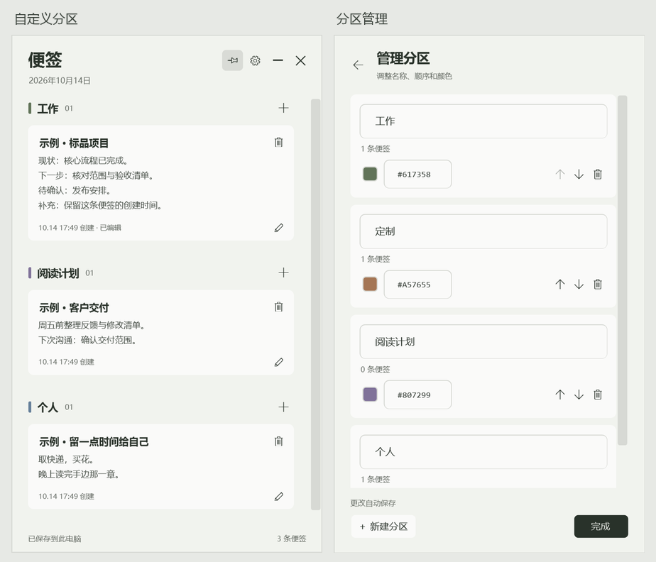

# 桌面便签 · Desktop Notes

一个极简的 Windows 桌面便签工具。保留原来的本地便签，同时可以连接 Linear，在同一个小窗口里查看项目与项目文档。

A small Windows notes app with customizable local sections plus a lightweight, read-only Linear projects and documents view. Built with C# and WPF. The interface is currently in Simplified Chinese.



## 下载与使用

从 [Releases](https://github.com/axzhang1216/desktop-notes/releases/latest) 下载 Windows 压缩包，解压后双击 `DesktopNotes.exe`。

运行环境：Windows 10 / 11，.NET Framework 4.8。程序以普通用户权限运行。

- 点击分区右侧的 **＋**，输入标题与多行内容。暂停输入约半秒后自动保存。
- 点击标题或编辑图标继续修改，长内容可展开、收起。
- 创建时间会持续保留；修改内容时另记更新时间。悬停时间或进入编辑界面查看完整记录。
- 顶部 **L** 按钮切换到 Linear 项目视图；再次点击返回本地便签。
- 拖动顶部移动窗口，拖动边缘缩放，图钉按钮控制置顶。
- 窗口位置、大小和置顶状态会在下次启动时恢复。再次运行程序会唤回已有窗口。
- `Ctrl+S` 立即保存，`Esc` 返回上一层。

## Linear 项目与文档

首次进入 Linear 视图时输入 Linear Personal API Key。密钥用 Windows DPAPI（CurrentUser）加密后单独保存在本机，不会写入 `notes.json` 或便签备份。

当前 Linear 集成为只读模式：

- Linear Project 显示为项目分组，并显示项目摘要与状态。
- Linear Document 显示为便签风格的卡片。
- 长文档可以直接在窗口里展开与收起。
- 卡片右上角的 `↗` 可以打开对应 Linear 页面。
- Linear 视图中的刷新按钮会重新读取项目与文档。
- 右键顶部 **L** 按钮可以管理或断开 Linear 连接。

更多连接说明见 [`docs/linear.md`](docs/linear.md)。

## 自定义分区

打开 **设置 → 管理分区**：

- 新增分区，自定义名称与颜色。
- 使用上移、下移按钮调整展示顺序。
- 直接修改名称；确认输入后自动保存。
- 删除空分区，或将分区内的便签迁移到另一个分区后再删除。

每个分区有稳定的 ID，重命名和排序会保留便签归属。迁移便签时保留标题、内容及原有时间。删除分区前会保存一份恢复备份。最后一个分区含有便签时，需要先创建接收分区。

首次使用提供「标品 / 定制 / 个人」三个可编辑分区。分区数量由你决定。

## 配色

内置纸白、雾灰、鼠尾草和夜色四套主题。应用主题会更新背景、文字和分区颜色；可以继续分别调整。

- 背景与文字：在设置中选择颜色或输入 `#RRGGBB`。
- 分区颜色：在分区管理中分别设置。

## 本地保存、备份与升级

数据保存在当前 Windows 用户的目录中：

```text
%LOCALAPPDATA%\ZoeyDesktopNotes\notes.json
```

设置中的 **打开数据文件夹** 可直接定位数据。应用的便签与备份操作均在本机完成。

- **导出备份**：生成包含分区、顺序、颜色、便签与时间的 JSON 文件。
- **导入备份**：先校验格式与分区归属，再显示待恢复数量。确认后恢复所选备份；当前内容会另存为 `before-import-*.json`。
- 日常保存使用临时文件与原子替换，并保留 `notes.json.bak`。
- 启动时遇到主文件损坏，会尝试上一份有效数据，并保留原文件供检查。
- v1 数据及备份会自动转换成 v2。首次升级主文件前，保存 `before-upgrade-v2-*.json`；原有便签、分区颜色与时间保持。
- 删除分区前保存 `before-section-delete-*.json`，需要撤回时可导入对应备份。

回退到 v1 程序前，请导出当前数据，再使用升级前的 v1 备份恢复数据文件。v1 程序适用于 v1 格式。

备份导入上限为 64 MB。窗口位置保持当前设备上的设置。

## 从源码构建

使用 Windows PowerShell 或 PowerShell 7，在仓库目录运行：

```powershell
.\build.ps1
```

产物位于 `bin\DesktopNotes.exe`。构建使用 Windows 自带的 .NET Framework C# 编译器，源码采用 UTF-8。

运行数据与分区模型检查：

```powershell
.\build.ps1 -Test -StoreOnly
```

在 Windows 桌面会话中运行完整窗口交互检查：

```powershell
.\build.ps1 -Test
```

测试在 `bin\test-*` 使用独立数据并生成结果与截图。窗口测试会短暂显示测试窗口。CI 执行构建与数据模型检查；完整界面、置顶、窗口恢复和配色检查在 Windows 桌面上执行。

可以指定独立的数据位置进行开发：

```powershell
.\bin\DesktopNotes.exe --data C:\Temp\DesktopNotes-Test\notes.json
```

## 数据结构

当前版本使用 `desktop-notes.v2`：

- `Sections`：有序的分区列表，含 `Id`、`Name`、`Color`。
- `Notes`：`Section` 关联分区 ID，`CreatedUtc` 与 `UpdatedUtc` 存储带时区的 ISO 8601 时间。
- `Theme`：主题名、背景与文字颜色，以及兼容旧版本的预设色字段。
- `Window`：位置、大小和置顶状态。

加载与导入时校验分区 ID 唯一性、颜色格式、便签 ID、时间和分区引用。Linear 连接信息单独保存在 `linear.json`，不属于便签数据结构。

## 已知验证边界

当前主要在 Windows 11 上验证。多显示器的混合缩放、特定输入法与 Windows 10 主题差异仍需要更多使用反馈。

部分设备的应用控制策略可能要求可执行文件满足签名或管理员策略。请遵循设备所属环境的应用运行政策。

## 许可证

[MIT](LICENSE) © 2026 Zoey Zhang。
